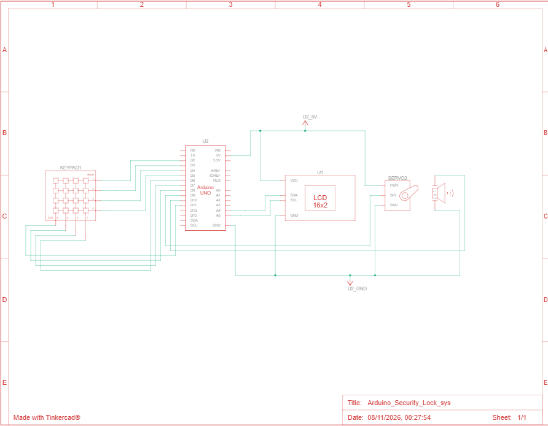
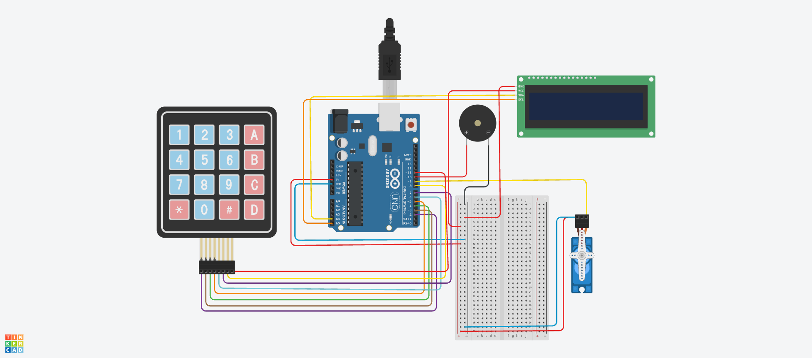

# Arduino Password-Protected Security Lock (Keypad System)

A secure, interactive door-lock prototype built using an Arduino Uno, a 4x4 matrix keypad, an I2C 16x2 LCD display, a servo motor, and a piezo buzzer. 

---

## Features
* **Secure PIN Entry:** Real-time character masking (`*`) on the LCD screen during input.
* **Actuator Control:** Automatically unlocks a servo motor upon entering the correct PIN (`1234`) and relocks after 5 seconds.
* **Error Handling & Lockout:** Tracks failed attempts and triggers an active audio-visual security alarm lockout after 3 consecutive wrong tries.
* **Optimized Wiring:** Uses an I2C communication module to minimize LCD wiring complexity.

---

## Component Requirements & Wiring

| Component | Arduino Pin / Connection |
| :--- | :--- |
| **Servo Motor (Signal)** | Pin `D11` (PWM) |
| **Buzzer (+)** | Pin `D10` |
| **Keypad Rows (1-4)** | Pins `D2, D3, D4, D5` |
| **Keypad Columns (1-4)** | Pins `D6, D7, D8, D9` |
| **I2C LCD Display (SDA / SCL)** | Analog Pins `A4 (SDA)` / `A5 (SCL)` |
| **Power (5V & GND)** | Connected to Arduino 5V and Common Ground |

---

## Circuit Diagram & Simulation Screenshot

### Circuit Schematic

### Prototype Screenshot

---

## Required Arduino Libraries
Make sure to install these libraries via the **Arduino IDE Library Manager** before compiling:
1. **Keypad** (by Mark Stanley, Alexander Brevig)
2. **Servo** (Built-in standard library)
3. **LiquidCrystal_I2C** (by Frank de Brabander)

---

## Code Usage
1. Clone or download this repository.
2. Open the `.ino` file inside the Arduino IDE.
3. Verify your I2C LCD address (`0x20` or `0x27` depending on your module) and pin configurations.
4. Upload the code to your Arduino Uno board!
